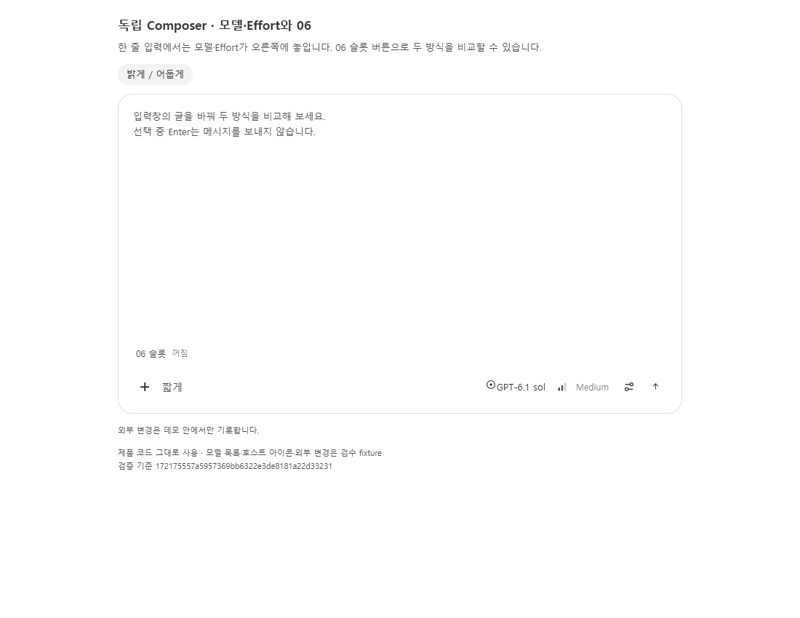
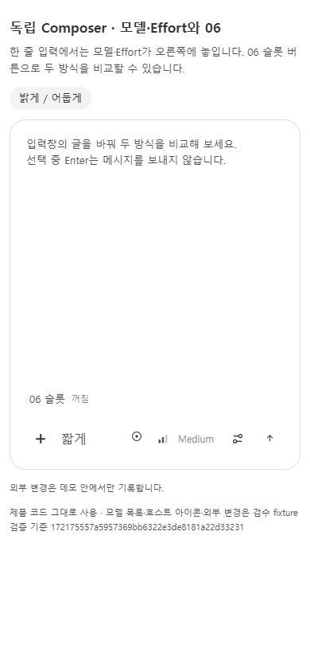
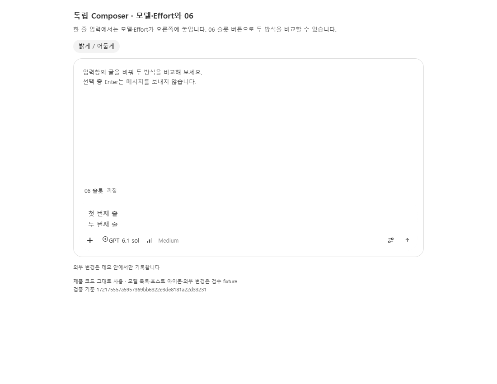
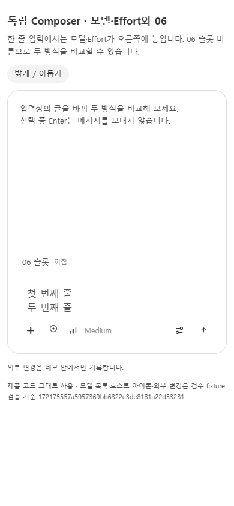
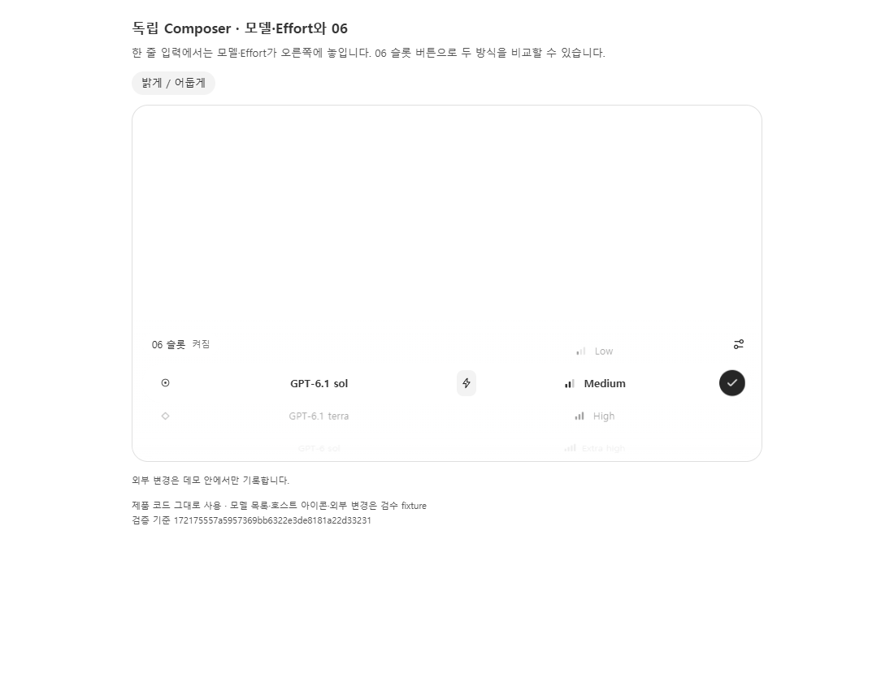
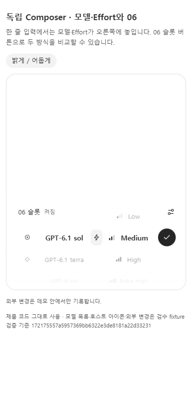

# 2026-11-09 검수 기록

검증한 코드: `172175557a5957369bb6322e3de8181a22d33231`. 캡처 추가 커밋은 제품 코드를 바꾸지 않는다.

모델·Effort와 06 슬롯, 동일 입력 노드와 초안 보존, 400ms 펼침·150ms 접힘, 호스트 초안 복귀를 실제 제품 컴포넌트로 검사했다. 원격 main의 iPhone Enter/beforeinput·첫 프레임·caret 수정과 병합했으며 전체 28 + 273개 검사와 타입·빌드가 통과했다. 기존 성능 검사 skip 3개는 유지한다.

캡처는 합성 데이터가 주입된 제품 코드의 Chrome 검수다. phone은 모바일 입력 특성의 브라우저 문맥 또는 좁은 화면 fixture이며 실제 휴대폰 캡처가 아니다. 실제 IME·마이크·업로드·외부 전송과 최종 BB 실화면은 별도 검수 대상이다. 자세한 수치와 범위는 [validation.json](validation.json)을 본다.
